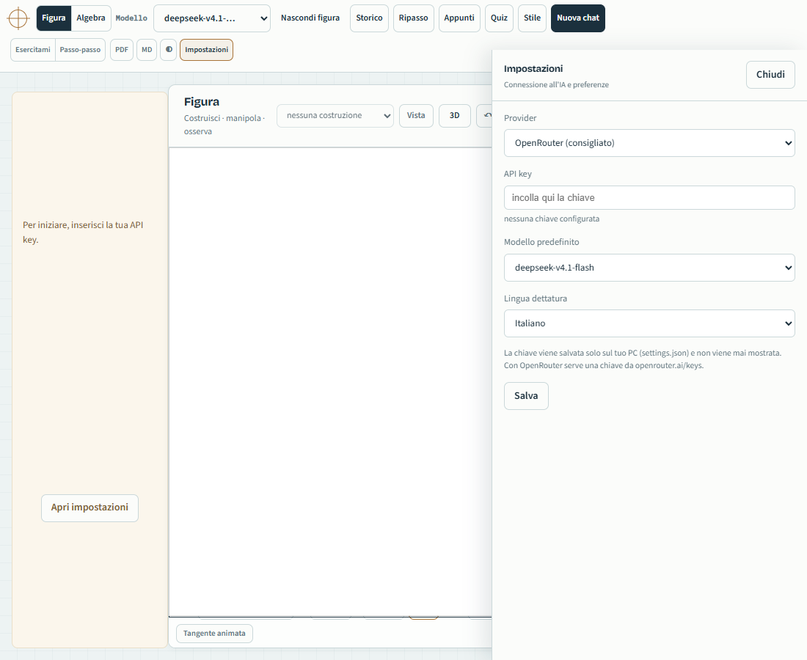

# MathApp

[](https://github.com/J0hnDoeMB/MathApp/actions/workflows/syntax.yml)

App locale: **chat con un'IA di matematica** + **GeoGebra** che l'IA può disegnare, il tutto sul PC.
L'IA spiega a parole e in LaTeX; quando serve, disegna nell'applet GeoGebra che vedi e puoi manipolare.



## Avvio rapido (Windows)
Doppio click su **`setup.cmd`** oppure, da PowerShell:
```powershell
powershell -ExecutionPolicy Bypass -File .\setup.ps1
.\start-mathapp.ps1
```
`setup.ps1` scarica Node.js LTS portatile in `.tools\` (nessun admin) e controlla l'ambiente. Per SymPy/PDF usa `.\setup.ps1 -Math`; per aggiungere anche la dettatura `.\setup.ps1 -Full`. Guida: [`docs/SETUP-WINDOWS.md`](docs/SETUP-WINDOWS.md).

## Avvio manuale
Doppio click su `start-mathapp.ps1` (oppure esegui in PowerShell):
```powershell
powershell -ExecutionPolicy Bypass -File .\start-mathapp.ps1
```
Si apre il browser su http://127.0.0.1:8790

In alternativa: `npm start` (stesso server; il browser va aperto a mano).

## Configurazione (API key)

Al primo avvio compare un banner: apri **Impostazioni**, scegli il provider (**OpenRouter** consigliato, oppure OpenCode Go se hai gia una chiave opencode), incolla la chiave e salva. Da quel momento l'app usa la tua chiave; modello predefinito e lingua della dettatura si scelgono nella stessa finestra.

La chiave resta in `settings.json`, solo sul tuo PC, e non viene mai mostrata. Senza chiave l'app resta utilizzabile per il quaderno SymPy/GeoGebra ma la chat non risponde. Le dipendenze Python (SymPy, Whisper) sono opzionali: senza di esse restano disponibili chat e GeoGebra.

## Core e funzionalità opzionali

| Funzione | Richiede | Se manca |
|---|---|---|
| Chat AI, API key, conversazioni, impostazioni | Node.js | - |
| GeoGebra e LaTeX | browser + internet (CDN) | la chat funziona, manca il disegno |
| Calcolo esatto, studio di funzione, matrici, vettori | Python + SymPy | la chat funziona; il quaderno esatto no |
| Dettatura | Python + faster-whisper | il microfono non è disponibile |
| Quiz, ripasso, appunti, stile, TTS | solo l'app | - |

Il **core è Node-only**: non serve Python per avviare, chattare, disegnare o salvare le conversazioni. Python/SymPy/Whisper sono opzionali e vengono rilevati all'avvio.

La modalità predefinita è **Essenziale** (chat + GeoGebra + calcolo esatto + conversazioni). Quiz, ripasso, appunti, stile, TTS e delega si abilitano da **Impostazioni → Modalità → Completa**; gli endpoint e i tool relativi restano spenti finché non la attivi.

Il **livello di dettaglio** (Auto, Sintetico, Dettagliato, Approfondito) si sceglie nelle stesse Impostazioni: cambia quanto spazio dare a passaggi, esempi e teoria, non i contenuti. Il tutor spiega il perché dei passaggi e chiude con una breve domanda di controllo quando serve.

Ogni risposta che usa calcoli esatti mostra un riepilogo **SymPy: N calcoli esatti**. Se la risposta contiene matematica ma non ha usato SymPy, compare un avviso: il badge è volutamente onesto, perché il calcolo esatto non garantisce che il testo lo riporti correttamente.

## Architettura
`server.mjs` è il guscio HTTP (sicurezza, router, statici, avvio, ~58 righe); le API stanno in `routes/` (settings, backup, compute, conversations, chat + plugin kb/profile/review/study caricati on-demand) e i servizi di dominio in `lib/`: `agent`, `chat-service`, `security`, `prompts`, `tools`, `sympy`, `geogebra`, `documents`, `audio`, `kb`, `profile`, `review`, `study`, `features`, `session-store`, `schema`, `storage`, `levels`. Le dipendenze vanno solo verso il basso (`server → routes → servizi → storage/config`), senza import circolari. Mappa completa e contratti in [`docs/ARCHITECTURE.md`](docs/ARCHITECTURE.md) e [`docs/CONTRACTS.md`](docs/CONTRACTS.md); entità e versioni in [`docs/DATA-MODEL.md`](docs/DATA-MODEL.md); direzione e fasi in [`docs/ROADMAP.md`](docs/ROADMAP.md); release policy in [`docs/RELEASE.md`](docs/RELEASE.md); onboarding tecnico in [`docs/ONBOARDING.md`](docs/ONBOARDING.md).

## Diagnostica

- `.\start-mathapp.ps1 -Check` mostra Node/Python/SymPy/Whisper, porta e chiave senza avviare il server.
- In **Impostazioni → Funzionalità** vedi lo stato e puoi ricontrollare.
- Problemi comuni: [`docs/TROUBLESHOOTING.md`](docs/TROUBLESHOOTING.md).

## Come si usa
- All'avvio la scheda **Inizia da qui** propone tre esempi cliccabili; sparisce al primo messaggio e torna con **Nuova chat**.
- Scrivi la domanda nella chat (a destra). Invio per inviare, Shift+Invio per andare a capo.
- L'IA può usare due strumenti: **SymPy** (calcolo esatto) e **GeoGebra** (disegno + modifica della geometria).
- **Figura / Algebra**: l'interruttore in alto cambia cosa vedi a sinistra (la chat resta sempre).
  - *Figura*: GeoGebra (l'IA disegna e modifica la geometria). Il pulsante **3D** accanto a "Pulisci"
    mostra la **vista tridimensionale** (assi x, y, z): l'IA la attiva da sola per geometria solida,
    superfici e funzioni di due variabili; le costruzioni 3D sono marcate con il badge **3D** e si
    ripristinano al reload insieme al resto. Il pulsante **⟲** riporta la vista 3D all'orientamento
    standard; se la vista si mette a girare da sola (trascinamento rimasto "appeso"), l'app la
    riporta automaticamente all'assetto stabile.
    Il pulsante **Vista** apre il riquadro della **finestra del grafico**: scegli gli intervalli
    **xmin/xmax/ymin/ymax**, accendi o spegni **assi** e **griglia**. **Applica** usa i valori scritti
    (se il minimo non è minore del massimo te lo dice), **Standard** torna a −10…10 e **Adatta**
    inquadra da sola le funzioni e i punti notevoli presenti. La finestra è parte della sessione:
    la ritrovi al reload e riaprendo una voce dello Storico. Vale per il piano 2D (in vista 3D l'app avvisa).
  - *Algebra*: il **quaderno di calcolo**; scrivi un'espressione, scegli l'operazione e premi
    **Calcola** → risultato esatto immediato (senza IA). Le operazioni sono raggruppate (algebra, analisi,
    **matrici**: determinante, inversa, rango, trasposta — la matrice si scrive `[[1,2],[3,4]]`;
    **studio di funzione**: dominio, zeri, segno, derivate, massimi/minimi, asintoti; **vettori e spazi**:
    prodotto scalare e vettoriale, norma, angolo, proiezione, indipendenza e procedura di Gram-Schmidt);
    per derivate e serie c'è il campo **ordine**. Ogni voce è **numerata** con operazione, espressione, risultato incorniciato
    e il comando esatto (clicca il risultato per copiarlo; clicca l'**espressione** per rimetterla nel modulo).
    **↑** nella casella richiama l'ultima espressione. **Spiega** apre un riquadro nella voce con i passaggi
    raccontati dall'IA (parole semplici alternate all'algebra), salvato con il calcolo. Lo **studio di funzione**
    mostra un **referto** a punti (funzione, dominio, simmetrie, zeri, segno, limiti, derivate, crescenza,
    massimi/minimi, flessi, asintoti); **Disegna** lo porta sulla lavagna — curva, punti notevoli colorati per
    tipo e asintoti tratteggiati — e inquadra tutto da solo. Per i **vettori** si sceglie **2D o 3D** e **Disegna**
    li rappresenta con le frecce (i vettori dello spazio richiedono la vista 3D). A quaderno vuoto trovi
    quattro **esempi da provare** con un clic. I calcoli fatti dall'IA durante la chat finiscono qui con
    l'etichetta **IA**.
- **Sessione persistente**: se ricarichi la pagina (F5) ritrovi **tutto** — conversazione, **figure GeoGebra** (anche
  le modifiche fatte a mano) e **quaderno algebrico**. Nulla viene azzerato.
  Il ripristino è **auto-riparante**: se la sessione salvata non esiste più recupera la più recente; se lo stato esatto
  della figura manca, la **ricostruisce** dai comandi dell'ultima costruzione. Se qualcosa non torna, il motivo è
  scritto nella console del browser (nessun fallimento silenzioso).
- **Storico delle costruzioni**: ogni voce della **Cronologia** conserva le sue figure e i suoi calcoli (indicati come
  `N figure · N calcoli`); riaprendola si ripristina quella sessione, non solo la chat. "Nuova chat" avvia invece
  una sessione nuova e vuota.
- **Strumenti di studio** (barra in alto):
  - **■ Stop** (o `Esc`): interrompe la risposta mentre si genera.
  - **↻ Rigenera** (o `Alt+R`): rifà l'ultima risposta senza riscrivere la domanda.
  - **⧉ Copia** su ogni risposta (Markdown) e **clic su una formula in blocco** per copiarne il LaTeX.
  - **Modo del tutor** (selettore **Esercitami / Passo-passo** nella barra, stessa grafica di Figura/Algebra):
    i due modi si escludono a vicenda, la scelta è ricordata e quando è attivo una striscia sopra la casella
    di scrittura lo ricorda, con un pulsante **Esci**.
    - *Esercitami*: il tutor non dà la soluzione, ti guida con domande e verifica i tuoi passaggi con SymPy.
    - *Passo-passo*: la risposta si rivela un blocco alla volta con "Passo successivo ▶".
  - **★ Ripasso**: salva una risposta da rivedere (una voce per risposta, niente duplicati; il pulsante diventa
    "★ Salvato"). Il pannello **Ripasso** elenca le voci come schede con data e **anteprima formattata**
    (formule comprese): **Mostra risposta** la legge senza cambiare sessione, **Apri sessione** riapre la
    conversazione, **Elimina** chiede conferma. Il contatore nel titolo mostra quante voci ci sono.
  - **PDF / MD**: esporta la sessione (finestra pronta da stampare/salvare in PDF, oppure file Markdown).
  - **◐ tema** chiaro/scuro, **tok N** = token usati nella sessione.
  - Scorciatoie: `Ctrl+K` cursore nella casella, `Alt+N` nuova chat, `↑` richiama l'ultima domanda.
  - **Badge "✔ verificato con SymPy"**: ogni risultato calcolato mostra il comando esatto usato.
  - **Riepilogo verifica**: sotto la risposta, **SymPy: N calcoli esatti** oppure un avviso se la matematica non è passata dal calcolo simbolico.
  - Nel quaderno, ogni cella ha **→ calcolo** (porta il risultato nella casella) e **→ chat** (lo mette nella domanda).
  - **Cronologia** con **ricerca** per argomento.
- **Lettura disturbata no**: mentre l'IA scrive puoi **scorrere in alto** senza essere riportato giù a forza.
  Compare un pulsante **"↓ Vai in fondo"** per tornare all'ultimo messaggio quando vuoi (sparisce da solo appena sei in fondo).
- **Modifica e rinvia**: passa il mouse su un tuo messaggio → appare **✎**. Aprilo, cambia il testo e premi
  **Salva e rinvia** (o Invio): la conversazione **riparte da quel punto** e l'IA rigenera la risposta.
  Dentro l'editor puoi anche **gestire gli allegati**: quelli già presenti sono mostrati (e rimovibili), e puoi
  **aggiungerne di nuovi** col pulsante **Allega**, incollandoli o trascinandoli nell'editor.
- **Costruzioni multiple e riproducibili**: ogni disegno dell'IA è una **costruzione** con un **titolo**, salvata
  nella chat come scheda con i pulsanti **Esegui** (ripulisce il grafico e la disegna), **Aggiungi** (la sovrappone
  a quello che c'è) e **Comandi** (mostra/nascondi i comandi modificabili).
  In alto a sinistra il menù **Costruzioni (N)** elenca tutte quelle della sessione: scegline una e torna sul grafico.
  Restano salvate nella conversazione (Cronologia) e vengono ripristinate al reload.
- **Revisione sempre attiva** (nessuna spunta da attivare): le costruzioni dell'IA **non finiscono subito sul grafico**.
  Arrivano nella chat con i **comandi in chiaro e modificabili**: li controlli, eventualmente li correggi, e solo allora
  premi **Esegui** o **Aggiungi**. Dopo l'esecuzione la scheda resta lì per rieseguirla o cambiarla ancora.
  (I comandi di stile `SetColor`, `SetVisible`… sono tradotti in chiamate API: `evalCommand` non li esegue.)
- **Due letture**: per ogni richiesta l'IA risponde SEMPRE con "Lettura algebrica" (formule e passaggi, calcoli
  esatti con SymPy) e "Lettura geometrica" (figura nell'applet + commento), quando il concetto lo consente.
- **Cronologia**: elenca gli argomenti già trattati (titolo = prima domanda); clicca per riaprire una conversazione.
- **Memoria di stile (Stile)**: l'IA **impara come vuoi le spiegazioni** e se le **rilegge prima di ogni risposta**.
  Le preferenze si accumulano in `data/profile.json` in due modi: **l'IA le registra da sola** (tool `ricorda`) quando
  la correggi sullo stile o esprimi un gusto stabile, oppure **le aggiungi tu** dal pannello **Stile** (con eliminazione).
  Prima di rispondere, tutte le preferenze vengono reinserite nel contesto con l'istruzione di rispettarle: il pannello
  mostra anche **quante volte** ciascuna è stata riletta. Registra solo preferenze durature, non il tema del momento.
- **Rete concettuale (Appunti)**: ogni allegato viene **salvato come FILE originale** (in `data/kb/files/`,
  riapribile dal pannello Appunti o dalla citazione) **e** indicizzato nel testo: PDF, testo e **trascrizioni audio**
  diventano blocchi con il numero di pagina. L'IA **usa da sola i tuoi documenti**: quando la domanda riguarda quel
  materiale li ritrova e li **cita** (`[analisi.pdf p.11]`), anche se non li hai ri-allegati in quella chat —
  non devi attivare nulla. Se la domanda **nomina** un documento ("i miei appunti di analisi") quel documento viene
  preferito; se il tema è estraneo, **non cita nulla**.
  Sotto la risposta compare la **casella della citazione** con il **passo che l'IA ha davvero ripreso**
  (confrontando la risposta con il testo, escludendo le parole del nome del file), evidenziato solo nelle parole
  effettivamente usate. **Se l'IA non si riferisce agli appunti, la casella non compare.**
  Il pannello **Appunti** elenca i documenti (con "Apri" per il file originale) e permette di eliminarli:
  eliminando un documento si cancellano file, blocchi e citazioni.
- **Dettatura vocale**: premi **🎤** e parla — il pulsante diventa rosso con il cronometro, ripremi per fermare.
  L'audio viene **trascritto in locale** con Whisper (niente servizi esterni) e il testo compare **nella casella**,
  pronto da controllare, correggere e inviare. Funziona da `127.0.0.1` (contesto sicuro richiesto dal microfono).
  Durante la trascrizione il pulsante mostra i secondi di attesa; la trascrizione usa il modello
  `large-v3-turbo` (accuratezza alta, ~2x il tempo reale su questa macchina) con lingua fissa (`it`), contesto
  matematico e termini tecnici. Il modello si **scalda all'apertura dell'app** e resta caldo in memoria.
- **Allegati**: passa file con **Allega**, **trascinandoli** nella chat o **incollandoli** (Ctrl+V) — immagini,
  PDF (testo estratto con pypdf), **audio** (trascritto in locale) e file di testo/codice. Max 4 file, 8 MB ciascuno.
  Restano legati al messaggio, quindi valgono anche per le domande successive.
- **Modelli e immagini**: il menu segna i modelli `· solo testo`. Se alleghi un'immagine a un modello che non la vede,
  entra in azione lo **strumento visione**: l'immagine viene trascritta (in LaTeX) da un modello che la vede e il testo
  passa al modello scelto, con un avviso in chat.
- "Nascondi figura" → chat a tutta larghezza. "Nuova chat" azzera conversazione, quaderno e allegati.
- Scegli il modello dal menù in alto (default `deepseek-v4.1-flash`).
- **Interrompere la risposta**: mentre l'IA risponde il pulsante **Invia** si trasforma in **Ferma** — un clic
  (o **Esc**) ferma subito la risposta; la parte già scritta resta con la nota "interrotto" e si può inviare
  una nuova domanda.

- **Audio**: allega una registrazione (mp3, wav, m4a, ogg…) → viene **trascritta in locale** con faster-whisper
  (open source, offline), con lingua e confidenza mostrate in chat. Nessun dato mandato a servizi esterni per la trascrizione.
  La stessa trascrizione viene riusata se lo stesso audio torna nella conversazione (cache per contenuto).
- **Orchestrazione multi-modello**:
  - *Escalation*: se il modello scelto non risponde (errore/indisponibile), si passa automaticamente al successivo
    (max 3 tentativi) e la risposta arriva lo stesso, con un avviso in chat.
  - *Tool `delega`*: il modello può consultare uno **specialista** e integrare la risposta —
    `esperto` (qwen3.8-max) per ragionamenti difficili, `verifica` (deepseek-v4-pro) per un secondo parere indipendente,
    `lungo` (deepseek-v4.1-flash, 1M di contesto), `visione`. Massimo 2 deleghe per risposta.
  - *Ripiego su OpenRouter*: se la chiave opencode risulta **scaduta o rifiutata** (401/403), l'app continua da sola
    su **OpenRouter** (stessa chiave utente in `auth.json`, modelli equivalenti, routing Morph-first) mostrando un
    avviso in chat; si disattiva con `MATHAPP_NO_OR_FALLBACK=1`.

## Ripasso, verifiche e strumenti (novità)
- **Ripasso (SM-2)**: salva come scheda le risposte da ricordare (pulsante nella risposta o flashcard dagli appunti).
  Il pannello **Ripasso** mostra le schede scadute, le propone una alla volta con **difficile / media / facile**
  e aggiorna gli intervalli con la ripetizione spaziata. Il pulsante in alto mostra il **numero di scadenze**;
  in fondo c'è l'**esportazione per Anki** (CSV pronto all'importazione, con HTML).
- **Flashcard dagli appunti**: dal pannello **Appunti** si generano automaticamente domande/risposte da un documento
  (con l'IA) e si possono aggiungere al Ripasso.
- **Quiz**: il pannello **Quiz** genera una verifica a scelta multipla su un argomento (3–10 domande) con
  **correzione**, **spiegazione** per ogni risposta e **timer** opzionale (1 minuto a domanda, allo scadere si corregge
  da solo). Le risposte sbagliate finiscono automaticamente nel **Ripasso**.
- **Statistica e regressione**: dati come `1, 2, 2, 3, 9` → media, mediana, quartili, deviazione standard, min/max;
  coppie come `1,2; 2,4` → **regressione lineare** con retta e punti sul grafico.
- **Numeri complessi**: `(3+4i)/(1-2i)` → risultato esatto, forma cartesiana, modulo e argomento, con
  **piano di Argand** (punto del numero, coniugato e segmenti dall'origine).
- **Somme parziali**: `1/2^n` → termini e somme parziali S₁…Sₙ come punti sul grafico, con la somma limite.
- **Sistemi lineari**: `x+y=3; x-y=1` → soluzione esatta e rette disegnate col punto di intersezione.
- **Area e tangente**: dalla barra degli strumenti figura puoi disegnare l'**area sotto la curva** (integrale definito,
  con segno) e la **tangente** in un punto, con **animazione** del punto di tangenza.
- **Etichette e ricerca**: le conversazioni si etichettano con i **tag** (`#verifica`); la ricerca in **Cronologia**
  cerca ovunque (titolo, testo, calcoli, tag), con `#tag` filtra per etichetta e mostra il passo trovato.
- **Studio su carta**: stampa della conversazione (con **foglio A/B** per le verifiche), **PDF del quaderno**,
  **PNG** dei grafici, **Undo/Redo** delle costruzioni, ascolto delle risposte (**TTS** italiano),
  **foto di un esercizio** dalla fotocamera e **backup automatico** dei dati in `data/backup/`.

## Dove stanno i dati
- `data/conversations/*.json` — le conversazioni salvate (per la Cronologia).
- `settings.json` — opzioni della trascrizione audio:
  - `whisperModel`: `large-v3-turbo` (default: più accurato, ~2x tempo reale), `medium`, `small` (veloce).
  - `whisperLanguage`: `it` (default) oppure `auto` per il rilevamento automatico della lingua.
  - Esempio: `{"whisperModel": "small", "whisperLanguage": "it"}` per dettature più rapide ma meno precise.
- I modelli audio (Whisper) si scaricano la prima volta in `~/.cache/huggingface` (il primo uso può richiedere qualche minuto).

## Privacy e chiavi API
- La chiave è salvata solo in `settings.json` sul PC, non viene mai restituita dall'API, non finisce nei log e non è inclusa nei backup (che copiano solo `data/`).
- Viene inviata esclusivamente al provider scelto (**OpenRouter** o **OpenCode Go**) via HTTPS; l'app non ha telemetria né server propri.
- **Rimuovi chiave** cancella il dato locale; per revocarla definitivamente usare la console del provider.
- Conversazioni, appunti e cronologia restano in `data/` sul PC.

## Requisiti
- Node.js. Opzionali: Python + SymPy per il calcolo esatto, pypdf per i PDF, Whisper per la dettatura.
- Su Windows `.\setup.ps1` scarica Node portatile e, con `-Math`/`-Full`, prepara le dipendenze Python.
- Connessione internet (per l'IA e per GeoGebra/KaTeX da CDN).
- La chiave API si configura in **Impostazioni** (salvata in `settings.json`) oppure, per compatibilita, si legge da `auth.json` di OpenCode; con OpenRouter basta incollare la chiave nelle Impostazioni.

## Sicurezza e verifiche
- Il server ascolta solo su `127.0.0.1:8790`: non inoltrare la porta verso la rete né cambiare il binding senza aggiungere autenticazione e protezioni adeguate.
- Richieste `POST`/`DELETE` provenienti da un'altra origine vengono rifiutate (CSRF); i body sono limitati a 64 MB e i file statici sono confinati a `public/`. `settings.json` viene scritto atomicamente e non viene mai servito.
- Le espressioni SymPy sono interpretate da un parser AST con whitelist matematica; non vengono eseguiti `eval`, `sympify` o `parse_expr` su input dell'utente. Sintassi Python non supportata viene rifiutata; esponenti simbolici, funzioni speciali e dimensioni/tempi dei calcoli sono limitati.
- Il server interrompe i calcoli SymPy dopo 20 s (configurabili con `MATHAPP_SYMPY_TIMEOUT_MS`), limita ogni output a 2 MiB e ammette al massimo due processi contemporanei; l'annullamento della chat interrompe anche l'upstream e non salva turni cancellati.
- L'HTML generato da Markdown viene ricostruito con una whitelist di elementi e attributi; HTML raw, handler JavaScript e URL `javascript:` vengono rimossi. I risultati LaTeX e i dettagli degli strumenti sono inseriti come testo.
- Aprire un argomento dallo Storico annulla lo stream precedente e ripristina messaggi, calcoli, costruzioni, modalità e stato GeoGebra. Il caricamento GeoGebra attende il callback; le scritture dello stato hanno revisioni monotone per ignorare snapshot vecchi arrivati tardi.
- Test parser: `python -m unittest test_sympy_cli -v`.
- Test rapidi senza server: `npm test` (62 check: 19 test dei moduli + 4 del loop agente + 4 chat-service + parser + security/session smoke con CSRF, body cap, path traversal, modalità core, API impostazioni, schema/migrazione, persistenza e route feature); `npm run test:py` per SymPy.
- Smoke browser: `npm run test:ui` (8 check: UI, state store, nuova chat, ripristino sessione/view); richiede Edge/Chrome e `puppeteer-core`, in CI è automatico.
- Test server (cancellazione, revisioni legacy/ordinate e timeout): `node test_server_cancel.mjs` (usa solo una copia temporanea in `%LOCALAPPDATA%\Temp\opencode`).
- Test trascrittore (protocollo worker e riutilizzo del modello): `node test_whisper.mjs` (con MathApp avviata).
- Test UI (con MathApp già avviata su `127.0.0.1:8790`): `node test_xss.mjs`, `node test_conversation_restore.mjs`, `node test_conversation_switch.mjs`, `node test_geogebra_state.mjs`, `node test_geogebra_3d.mjs`, `node test_layout.mjs`, `node test_tutor.mjs`, `node test_review.mjs`, `node test_algebra_ui.mjs`, `node test_vista.mjs` e `node test_analisi.mjs`. Richiedono Puppeteer: `npm i -D puppeteer` oppure `MATHAPP_PUPPETEER=<path>`; `test_geogebra_3d.mjs` avvia Chrome con WebGL software per la vista 3D.
- Test delle funzioni nuove (con MathApp avviata): `node test_lavagna.mjs` (undo, PNG, dettatura, foglio stampabile), `node test_strumenti.mjs`, `node test_tts.mjs`, `node test_fasec.mjs` (statistica, regressione, complessi, parziali, sistemi, area, tangente animata), `node test_tags.mjs` (etichette e ricerca globale), `node test_ripasso.mjs` (SM-2, export Anki, flashcard), `node test_quiz.mjs` (quiz completo), `node test_stop.mjs` (il pulsante Invia diventa Ferma e interrompe la risposta). Senza server: `node test_flashparse.mjs`, `node test_quizparse.mjs` (parser delle schede e dei quiz).

## File
- `server.mjs` — guscio HTTP: sicurezza, router, statici, avvio
- `routes/` — API settings, backup, kb, profile, review, study, compute, conversations, chat
- `lib/chat-service.mjs`, `lib/security.mjs` — orchestrazione chat e guardie HTTP
- `public/state.js` — store client domain/UI con eventi
- `test_ui_smoke.mjs` — smoke browser (nuova chat, restore, view)
- `setup.cmd`, `setup.ps1` — setup Windows: Node portatile, Python/SymPy opzionali
- `requirements.txt`, `requirements-whisper.txt` — dipendenze Python opzionali
- `docs/SETUP-WINDOWS.md` — guida di installazione rapida
- `docs/ARCHITECTURE.md` — mappa dei moduli e regole di dipendenza
- `docs/CONTRACTS.md`, `docs/DATA-MODEL.md` — contratti dei layer/port e modello dati
- `sympy_cli.py` — calcolo esatto
- `transcribe.py` — trascrizione audio locale (worker persistente con modello caldo)
- `test_sympy_cli.py`, `test_xss.mjs`, `test_conversation_restore.mjs`, `test_conversation_switch.mjs`, `test_geogebra_state.mjs`, `test_geogebra_3d.mjs`, `test_server_cancel.mjs`, `test_whisper.mjs`, `test_algebra_ui.mjs`, `test_layout.mjs`, `test_tutor.mjs`, `test_review.mjs`, `test_vista.mjs`, `test_analisi.mjs`, `test_lavagna.mjs`, `test_strumenti.mjs`, `test_tts.mjs`, `test_fasec.mjs`, `test_tags.mjs`, `test_ripasso.mjs`, `test_quiz.mjs`, `test_stop.mjs`, `test_flashparse.mjs`, `test_quizparse.mjs` — regressioni parser, XSS, sessioni/GeoGebra (anche 3D), server, trascrittore, quaderno, layout, modo tutor, ripasso, pannello Vista, laboratorio di analisi, lavagna, strumenti, dettatura, fasi C/D (dati, tag, quiz) e parser di flashcard/quiz
- `lib/flashparse.mjs`, `lib/quizparse.mjs` — parser delle flashcard e dei quiz generati dall'IA
- `lib/config.mjs`, `lib/models.mjs`, `lib/llm.mjs`, `lib/log.mjs` — configurazione/provider, catalogo modelli, client LLM (OpenCode/OpenRouter) e log
- `lib/agent.mjs`, `lib/prompts.mjs`, `lib/tools.mjs` — loop agente, prompt e schema degli strumenti
- `lib/sympy.mjs`, `lib/geogebra.mjs`, `lib/documents.mjs`, `lib/audio.mjs` — calcolo esatto, ponte GeoGebra, PDF/testo, Whisper
- `lib/session-store.mjs`, `lib/schema.mjs` — repository sessioni/stato/cronologia, validazione e migrazioni
- `lib/review.mjs`, `lib/study.mjs`, `lib/features.mjs` — SM-2, generazione studio, gate core/full
- `lib/storage.mjs`, `lib/kb.mjs`, `lib/profile.mjs`, `lib/levels.mjs`, `lib/util.mjs` — percorsi/backup, appunti, stile, livelli e utility
- `extract.py` — estrazione testo dai PDF
- `public/` — pagina (GeoGebra + chat + quaderno)
- `start-mathapp.ps1` — avvio
