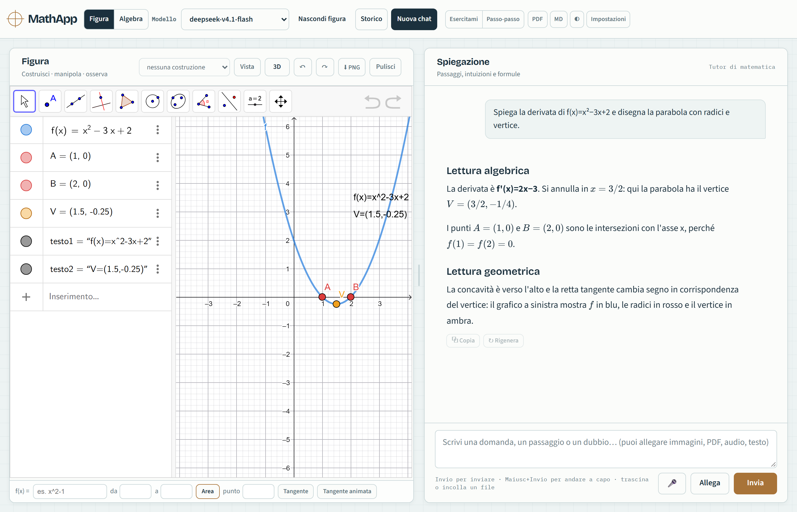

# MathApp

[](https://github.com/J0hnDoeMB/MathApp/actions/workflows/syntax.yml)

Tutor di matematica **locale** con chat AI, GeoGebra e calcolo esatto SymPy. La API key resta sul tuo PC.



## Avvio rapido

### Windows

Doppio click su **`setup.cmd`**, poi `start-mathapp.ps1`. Oppure:

```powershell
powershell -ExecutionPolicy Bypass -File .\setup.ps1
.\start-mathapp.ps1
```

`setup.ps1` scarica Node.js LTS portatile in `.tools\` (nessun admin). Con `-Math` installa Python/SymPy/pypdf; con `-Full` anche faster-whisper.

### macOS / Linux

Serve Node.js 18+ e, facoltativamente, Python 3:

```bash
python3 -m venv .venv
. .venv/bin/activate
python -m pip install -r requirements.txt   # SymPy + pypdf (opzionale)
npm start
```

Apri `http://127.0.0.1:8790`. `setup.ps1`/`start-mathapp.ps1` sono solo Windows; su macOS/Linux il core è `npm start`. Per la dettatura: `pip install -r requirements-whisper.txt`. Dettagli: [`docs/SETUP-MACOS-LINUX.md`](docs/SETUP-MACOS-LINUX.md).

## Cosa include

- **Core**: chat, sessioni/cronologia, GeoGebra, SymPy, backup, sicurezza.
- **Completa** (opzionale): quiz, ripasso, appunti/KB, flashcard, TTS, dettatura, stile. Si attiva da **Impostazioni → Modalità**.
- **BYO key**: OpenRouter o OpenCode Go, configurata in Impostazioni. Nessuna telemetria; la chiave non è nei backup.

## Qualità

```bash
npm test          # 80 check Node
npm run test:ui   # 16 check browser (richiede Edge/Chrome + puppeteer-core)
npm run test:geo  # 5 check GeoGebra (richiede CDN)
npm run eval      # 17 casi SymPy
npm run test:py   # 29 test Python (opzionale)
```

CI su Windows con branch protection. Diagnostica: `GET /api/diagnostics` (alias `/api/health`) o `.\start-mathapp.ps1 -Check`.

## Documentazione

- [Guida completa](docs/USAGE.md)
- [Architettura](docs/ARCHITECTURE.md) · [Contratti](docs/CONTRACTS.md) · [Modello dati](docs/DATA-MODEL.md) · [Persistenza](docs/PERSISTENCE.md)
- [Capabilities](docs/CAPABILITIES.md) · [Sicurezza](docs/SECURITY-MODEL.md) · [Performance](docs/PERFORMANCE.md) · [Scorecard](docs/SCORECARD.md)
- [Setup Windows](docs/SETUP-WINDOWS.md) · [Setup macOS/Linux](docs/SETUP-MACOS-LINUX.md) · [Troubleshooting](docs/TROUBLESHOOTING.md)
- [Quality gate](docs/QUALITY-GATE.md) · [Osservabilità](docs/OBSERVABILITY.md) · [Limiti noti](docs/KNOWN-LIMITATIONS.md) · [ADR](docs/adr/)

## Struttura

```text
server.mjs        guscio HTTP
routes/           API (core + plugin opzionali on-demand)
lib/              dominio, adapter, storage, sicurezza, diagnostica
public/           UI, state store, feature plugins lazy
test/             test Node/browser/Python
eval/             casi matematici deterministici
docs/             guide, contratti e decisioni
```

Licenza MIT. Nessun dato personale nel repository.
